# DevSecOps Portfolio — Arij Belaid

[](https://arijbelaid.github.io/cv-onepage/)
[](https://hub.docker.com/)
[](https://www.jenkins.io/)

Application **One Page** évolutive réalisée en **HTML5 / CSS3 / JavaScript**, puis progressivement intégrée dans une démarche **DevSecOps** avec **Git, GitHub, SSH, Docker, Nginx, Docker Compose, Jenkins et Vagrant**.

Le projet a été réalisé sur une **VM Ubuntu Server** et permet de mettre en pratique l'administration Linux, la sécurisation SSH, la conteneurisation, le versionnement Git et les premières étapes d'automatisation.

---
## 📄 Rapport complet (PDF)

Le rapport détaillé du projet est disponible ici :

👉 **[Télécharger le rapport PDF](./rapport-devsecops-arij-belaid.pdf)**

---

# 1. Installation d'Ubuntu Server et accès SSH

## 🎯 Objectif

Installer **Ubuntu Server** sur une machine virtuelle et configurer un accès distant sécurisé avec **SSH**.

L'objectif est de pouvoir administrer la VM depuis la machine physique sans utiliser directement la console de la VM.

## 🔐 Vérification du service SSH

Après l'installation d'Ubuntu Server, le service SSH est vérifié avec :

```bash
sudo systemctl status ssh
```

Le service doit être actif :

```text
Active: active (running)
```

## 🔒 Sécurisation de SSH

La configuration SSH est vérifiée et sécurisée afin de permettre une administration distante contrôlée.

Le fichier de configuration principal est :

```bash
sudo nano /etc/ssh/sshd_config
```

Après modification de la configuration, le service SSH est redémarré :

```bash
sudo systemctl restart ssh
```

Puis son état est vérifié :

```bash
sudo systemctl status ssh
```

## 📸 Capture 01 — Service SSH

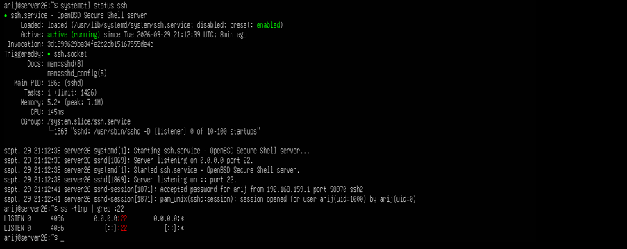

**Nom de la capture :**

```text
01-ssh-service.png
```

---

# 2. Test de l'accès SSH depuis la machine physique

## 🎯 Objectif

Tester la connexion SSH entre la **machine physique Windows** et la **VM Ubuntu Server**.

Depuis PowerShell sur Windows :

```powershell
ssh arij@IP_DE_LA_VM
```

Exemple :

```powershell
ssh arij@192.168.X.X
```

Une fois la connexion établie, le terminal affiche le shell de la VM Ubuntu Server.

## 📸 Capture 02 — Connexion SSH depuis Windows

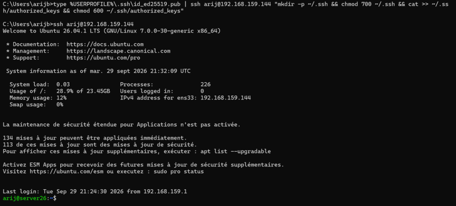

**Nom de la capture :**

```text
02-ssh-windows.png
```

---

# 3. Installation de Docker

## 🎯 Objectif

Installer **Docker Engine** sur Ubuntu Server afin de pouvoir conteneuriser et déployer le Portfolio.

## 📦 Installation des dépendances

Les dépendances nécessaires sont installées :

```bash
sudo apt update
sudo apt install ca-certificates curl gnupg
```

## 🔑 Ajout de la clé GPG Docker

Création du répertoire des clés :

```bash
sudo install -m 0755 -d /etc/apt/keyrings
```

Ajout de la clé officielle Docker :

```bash
curl -fsSL https://download.docker.com/linux/ubuntu/gpg | \
sudo gpg --dearmor -o /etc/apt/keyrings/docker.gpg
```

## 📦 Ajout du dépôt Docker

Le dépôt officiel Docker est ajouté aux sources APT.

## 🚀 Installation de Docker

```bash
sudo apt update
sudo apt install docker-ce docker-ce-cli containerd.io docker-buildx-plugin docker-compose-plugin
```

## ✅ Vérification du service

```bash
sudo systemctl status docker
```

Le service doit être actif :

```text
Active: active (running)
```

## 👤 Utilisation de Docker sans sudo

L'utilisateur est ajouté au groupe Docker :

```bash
sudo usermod -aG docker $USER
```

Une nouvelle session est ensuite ouverte afin d'appliquer les changements.

## 🧪 Test final

```bash
docker run hello-world
```

Cette commande permet de vérifier que Docker fonctionne correctement.

## 📸 Capture 03 — Installation de Docker

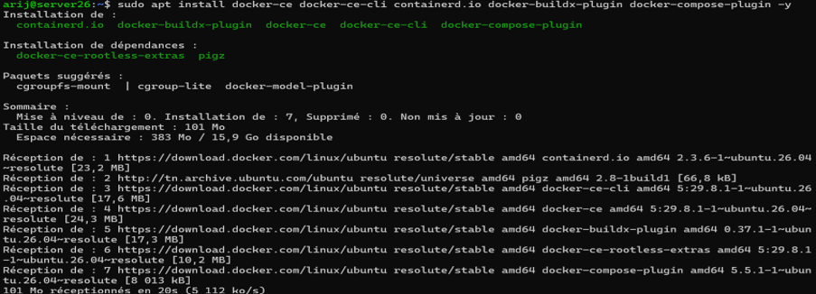

**Nom de la capture :**

```text
03-docker-installation.png
```

## 📸 Capture 04 — Vérification de Docker

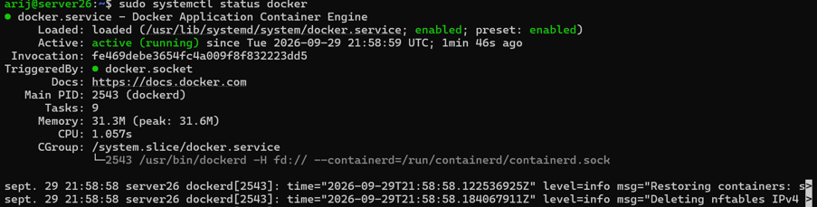

**Nom de la capture :**

```text
04-docker-service-test.png
```

---

# 4. Installation et configuration de Jenkins

## 🎯 Objectif

Installer **Jenkins en tant que service** afin de préparer l'environnement à l'automatisation et à la CI/CD.

## ☕ Installation de Java

Jenkins nécessite Java.

```bash
sudo apt update
sudo apt install fontconfig openjdk-21-jre
```

Vérification :

```bash
java -version
```

## 🔑 Ajout de la clé GPG Jenkins

La clé officielle Jenkins est ajoutée afin de pouvoir utiliser son dépôt.

## 📦 Ajout du dépôt Jenkins

Le dépôt Jenkins est ajouté aux sources APT.

## 🚀 Installation de Jenkins

```bash
sudo apt update
sudo apt install jenkins
```

## ▶️ Démarrer et activer Jenkins

```bash
sudo systemctl start jenkins
sudo systemctl enable jenkins
```

Vérification :

```bash
sudo systemctl status jenkins
```

## 🔥 Ouverture du port 8080

Le port utilisé par Jenkins est ouvert dans le pare-feu :

```bash
sudo ufw allow 8080/tcp
```

Vérification :

```bash
sudo ufw status
```

## 🔑 Récupération du mot de passe initial

```bash
sudo cat /var/lib/jenkins/secrets/initialAdminPassword
```

## 🌐 Accès depuis la machine physique

Depuis Windows, Jenkins est accessible avec :

```text
http://IP_DE_LA_VM:8080
```

## 📸 Capture 05 — Service Jenkins

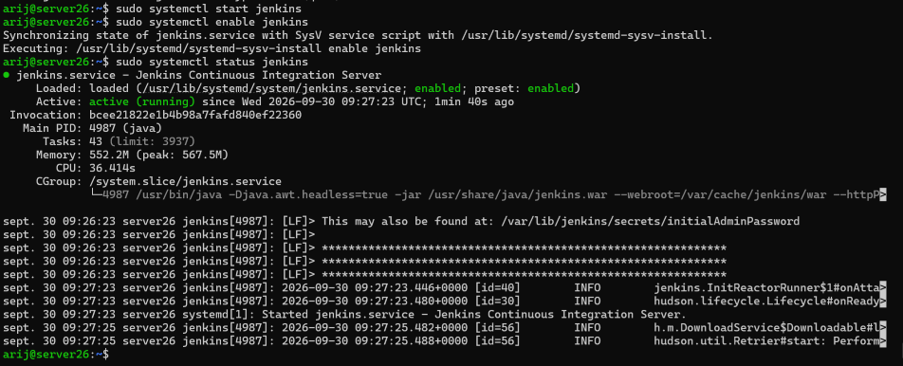

**Nom de la capture :**

```text
05-jenkins-service.png
```

## 📸 Capture 06 — Jenkins depuis Windows

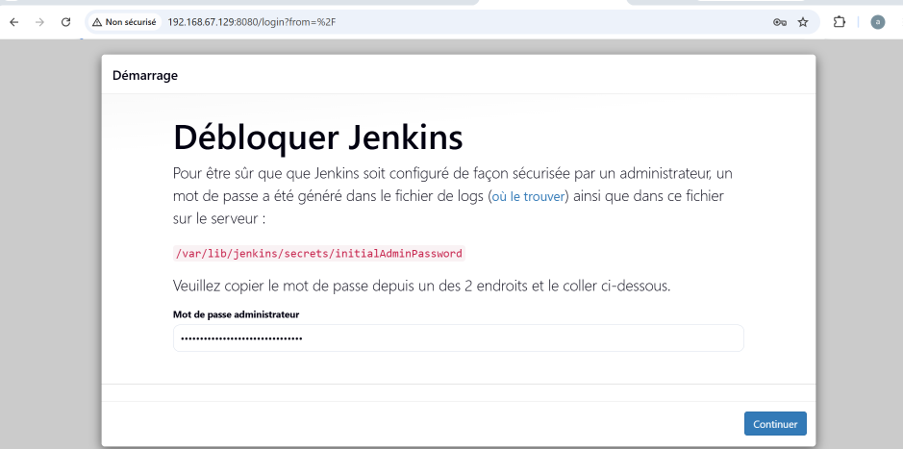

**Nom de la capture :**

```text
06-jenkins-web.png
```

---

# 5. Création du mini CV One Page

## 🎯 Objectif

Créer un **mini CV One Page** en utilisant :

* HTML5
* CSS3
* JavaScript
* Git

## 📁 Création du projet

Un dossier dédié au projet est créé :

```bash
mkdir cv-onepage
cd cv-onepage
```

Initialisation du dépôt Git :

```bash
git init
```

## 🔎 Vérification de Git

```bash
git --version
```

## ⚙️ Configuration de Git

```bash
git config --global user.name "Arij Belaid"
git config --global user.email "aarijbelaid@gmail.com"
```

## 📄 Fichiers du mini CV

Le projet contient notamment :

```text
cv-onepage/
├── index.html
├── style.css
└── script.js
```

### `index.html`

Structure HTML5 du CV.

### `style.css`

Mise en forme et design du CV.

### `script.js`

Gestion des interactions JavaScript.

## 📸 Capture 07 — Mini CV

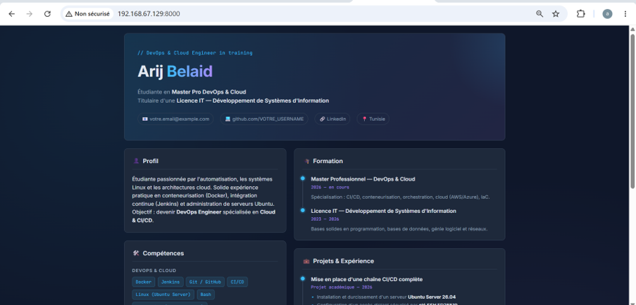

**Nom de la capture :**

```text
07-mini-cv.png
```

## 🔗 Dépôt GitHub

👉 **https://github.com/arijbelaid/cv-onepage**

---

# 6. Configuration des Push GitHub via SSH

## 🎯 Objectif

Configurer une authentification SSH entre la VM Ubuntu et GitHub afin de pouvoir effectuer des `git push` sans utiliser de mot de passe ou de token.

## 🔑 Vérifier les clés SSH existantes

```bash
ls -la ~/.ssh
```

## 🔐 Générer une paire de clés ED25519

```bash
ssh-keygen -t ed25519 -C "aarijbelaid@gmail.com"
```

La clé est générée dans :

```text
~/.ssh/id_ed25519
```

et la clé publique dans :

```text
~/.ssh/id_ed25519.pub
```

## 📋 Afficher la clé publique

```bash
cat ~/.ssh/id_ed25519.pub
```

La clé publique est ensuite ajoutée dans :

**GitHub → Settings → SSH and GPG keys → New SSH key**

## 🧪 Tester la connexion SSH avec GitHub

```bash
ssh -T git@github.com
```

Résultat attendu :

```text
Hi arijbelaid! You've successfully authenticated...
```

## 🔗 Configurer le dépôt local avec SSH

```bash
git remote set-url origin git@github.com:arijbelaid/cv-onepage.git
```

Vérification :

```bash
git remote -v
```

Résultat :

```text
origin  git@github.com:arijbelaid/cv-onepage.git (fetch)
origin  git@github.com:arijbelaid/cv-onepage.git (push)
```

## 📸 Capture 08 — Clé SSH GitHub

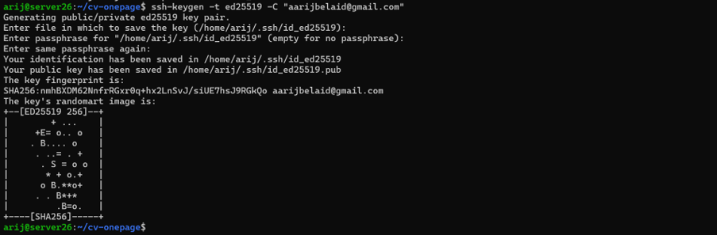

**Nom de la capture :**

```text
08-github-ssh-key.png
```

## 📸 Capture 09 — Test SSH GitHub

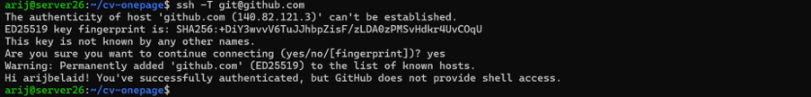

**Nom de la capture :**

```text
09-github-ssh-test.png
```

---

# 7. Évolution vers un DevSecOps Portfolio

## 🎯 Objectif

Faire évoluer le mini CV vers une petite application **DevSecOps Portfolio**.

Le Portfolio contient les sections principales :

* About
* Skills
* Projects
* Experience
* Contact

## 🛠️ Principales améliorations

Le mini CV initial a été transformé en une application One Page plus complète avec :

* une présentation personnelle ;
* une section About ;
* une section Skills ;
* une section DevSecOps ;
* une section Projects ;
* une section Experience ;
* une section Contact ;
* une interface responsive ;
* une organisation adaptée à un profil DevOps & Cloud.

Les fichiers principaux restent :

```text
index.html
style.css
script.js
```

## 🚀 Lancement en local

Le Portfolio peut être ouvert localement dans un navigateur afin de vérifier son fonctionnement avant publication.

## 📸 Capture 10 — DevSecOps Portfolio

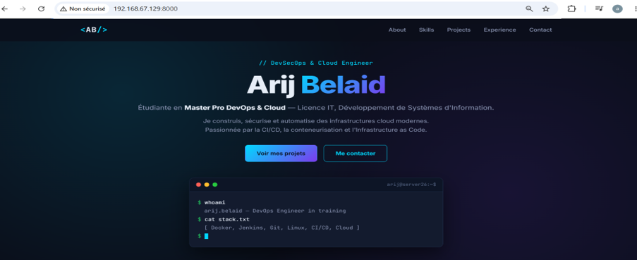

**Nom de la capture :**

```text
10-devsecops-portfolio.png
```

## 🌐 Démo en ligne

👉 **https://arijbelaid.github.io/cv-onepage/**

---

# 8. Section DevSecOps Skills

## 🎯 Objectif

Ajouter une section dédiée aux technologies DevSecOps utilisées ou étudiées pendant le projet.

## 🧰 Technologies présentées

La section **DevSecOps Skills** présente :

* Git
* Docker
* Jenkins
* Kubernetes
* Ansible
* Terraform
* Argo CD

Cette section permet de présenter clairement la stack technique associée au profil DevOps & Cloud.

## 📸 Capture 11 — DevSecOps Skills

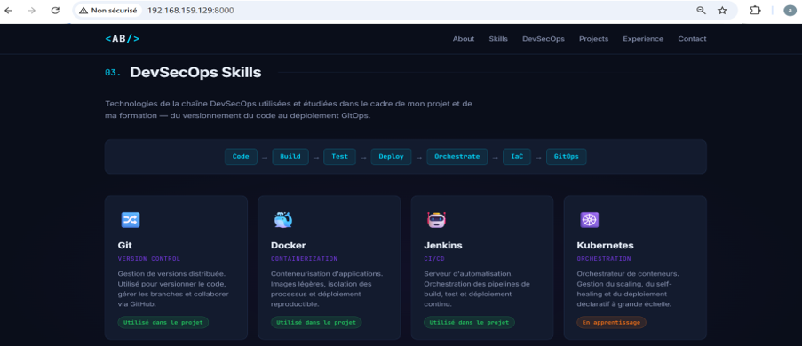

**Nom de la capture :**

```text
11-devsecops-skills.png
```

---

# 9. Génération dynamique des Projects

## 🎯 Objectif

La section **Projects** est générée dynamiquement en JavaScript à partir d'un **tableau d'objets**.

Les projets ne sont donc pas écrits individuellement dans le HTML : JavaScript génère automatiquement les cartes dans le DOM.

## 📄 Tableau des projets

### Extrait de `script.js`

```javascript
const projectsData = [
    {
        title: "Chaîne CI/CD complète sur Ubuntu Server",
        year: "2026",
        description: "Installation et sécurisation d'un serveur Ubuntu Server, déploiement de Docker et Jenkins.",
        tags: ["Ubuntu", "Docker", "Jenkins", "SSH", "UFW"],
        link: "https://github.com/arijbelaid/cv-onepage"
    },
    {
        title: "DevSecOps Portfolio",
        year: "2026",
        description: "Application One Page responsive développée en HTML5, CSS3 et JavaScript.",
        tags: ["HTML5", "CSS3", "JavaScript", "Git", "GitHub Pages"],
        link: "https://github.com/arijbelaid/cv-onepage"
    }
];
```

## 🧩 Génération d'une carte

```javascript
function createProjectCard(project) {
    const tagsHTML = project.tags
        .map(tag => `<li>${tag}</li>`)
        .join('');

    return `
        <article class="project-card">
            <div class="project-header">
                <span class="project-folder">📁</span>
                <span class="project-year">${project.year}</span>
            </div>

            <h3>${project.title}</h3>
            <p>${project.description}</p>

            <ul class="project-tags">
                ${tagsHTML}
            </ul>
        </article>
    `;
}
```

## 📌 Injection des projets dans le DOM

```javascript
function renderProjects() {
    const grid = document.getElementById('projectsGrid');

    if (!grid) return;

    grid.innerHTML = projectsData
        .map(createProjectCard)
        .join('');
}

renderProjects();
```

Cette approche permet d'ajouter facilement de nouveaux projets en ajoutant simplement un nouvel objet dans `projectsData`.

## 📸 Capture 12 — Projects dynamiques

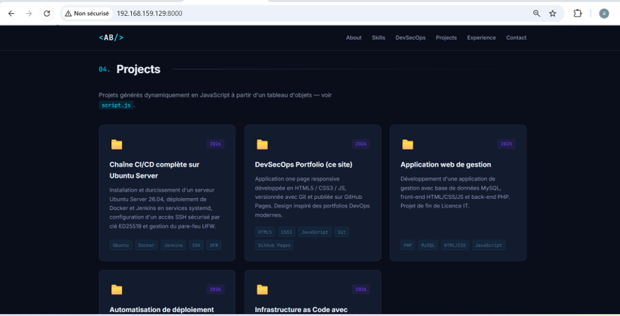

**Nom de la capture :**

```text
12-projects-dynamic.png
```

---

# 10. Dockerisation avec Nginx

## 🎯 Objectif

Créer un **Dockerfile** permettant de servir le DevSecOps Portfolio avec **Nginx**.

## 📁 Fichiers Docker

La dockerisation utilise notamment :

```text
Dockerfile
nginx.conf
.dockerignore
```

## 🐳 Dockerfile

```dockerfile
FROM nginx:alpine

COPY . /usr/share/nginx/html

EXPOSE 80

CMD ["nginx", "-g", "daemon off;"]
```

## 📄 Explication

### Image de base

```dockerfile
FROM nginx:alpine
```

Utilisation d'une image Nginx légère basée sur Alpine Linux.

### Copie du Portfolio

```dockerfile
COPY . /usr/share/nginx/html
```

Les fichiers du Portfolio sont copiés dans le répertoire utilisé par Nginx pour servir les fichiers statiques.

### Port

```dockerfile
EXPOSE 80
```

Le conteneur expose le port HTTP 80.

### Démarrage de Nginx

```dockerfile
CMD ["nginx", "-g", "daemon off;"]
```

Nginx est exécuté au premier plan afin que le conteneur reste actif.

---

# 11. Construction de l'image `cv-docker`

## 🎯 Objectif

Construire une image Docker nommée :

```text
cv-docker
```

## 🔨 Construction

Depuis le répertoire du projet :

```bash
docker build -t cv-docker .
```

## 🔎 Vérification

```bash
docker images
```

L'image `cv-docker` doit apparaître dans la liste des images Docker.

## 📸 Capture 13 — Image Docker `cv-docker`

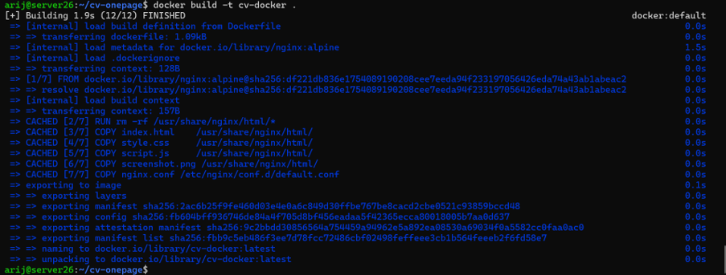

**Nom de la capture :**

```text
13-docker-build-cv-docker.png
```

---

# 12. Exécution du conteneur

## 🎯 Objectif

Lancer l'image `cv-docker` dans un conteneur et rendre le Portfolio accessible depuis la machine physique.

## 🚀 Lancer le conteneur

Le rapport utilise le port **8082** pour cette étape :

```bash
docker run -d --name cv-docker-container -p 8082:80 cv-docker
```

## 🔎 Vérifier le conteneur

```bash
docker ps
```

Le conteneur doit apparaître avec un mapping similaire à :

```text
0.0.0.0:8082->80/tcp
```

## 🔥 Ouvrir le port dans UFW

```bash
sudo ufw allow 8082/tcp
```

## 🧪 Tester depuis la VM

```bash
curl http://localhost:8082
```

## 🌐 Tester depuis la machine physique

Depuis le navigateur Windows :

```text
http://IP_DE_LA_VM:8082
```

Le Portfolio doit être accessible depuis la machine physique.

## 📸 Capture 14 — Docker Run et Docker PS

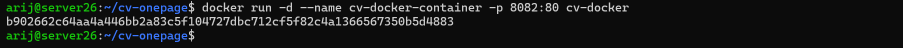

**Nom de la capture :**

```text
14-docker-run-ps.png
```

## 📸 Capture 15 — Portfolio depuis la machine physique

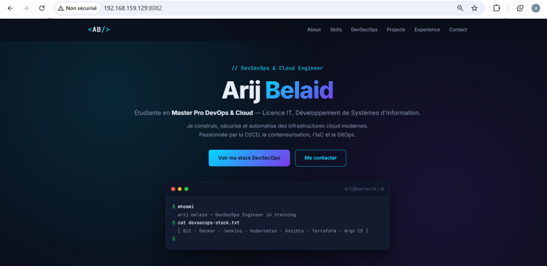

**Nom de la capture :**

```text
15-portfolio-docker-windows.png
```

---

# 13. Déploiement avec Docker Compose

## 🎯 Objectif

Automatiser le déploiement du Portfolio avec **Docker Compose**.

## 📄 Fichier Docker Compose

Le projet contient :

```text
docker-compose.yml
```

Le fichier permet de définir le service du Portfolio et sa configuration de déploiement.

## 🚀 Démarrer avec Docker Compose

```bash
docker compose up -d
```

L'option `-d` permet de lancer les services en arrière-plan.

## 🔎 Vérifier les services

```bash
docker compose ps
```

Le service doit apparaître avec l'état :

```text
Up
```

ou selon la configuration :

```text
healthy
```

## 📸 Capture 16 — Docker Compose

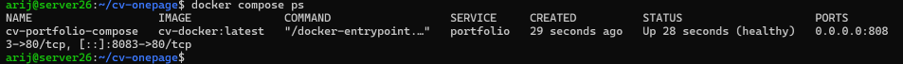

**Nom de la capture :**

```text
16-docker-compose-ps.png
```

---

# 14. Publication sur GitHub via SSH

## 🎯 Objectif

Publier toutes les modifications du projet sur GitHub en utilisant l'authentification SSH.

## 🔗 Dépôt GitHub

👉 **https://github.com/arijbelaid/cv-onepage**

## ⚙️ Vérifier l'état du dépôt

```bash
git status
```

## ➕ Ajouter les modifications

```bash
git add .
```

## 📝 Créer un commit

```bash
git commit -m "feat: deployment with Docker Compose"
```

## 🚀 Publier sur GitHub

```bash
git push
```

## 🔎 Vérifier le remote

```bash
git remote -v
```

Résultat attendu :

```text
origin  git@github.com:arijbelaid/cv-onepage.git (fetch)
origin  git@github.com:arijbelaid/cv-onepage.git (push)
```

## 🔐 Vérifier l'authentification SSH

```bash
ssh -T git@github.com
```

Résultat attendu :

```text
Hi arijbelaid! You've successfully authenticated...
```

## 📜 Historique des commits

```bash
git log --oneline
```

Quelques versions du projet :

```text
feat(v8): déploiement avec Docker Compose + healthcheck healthy
feat(v7): exécution du conteneur cv-docker + accès depuis la machine physique
feat(v5): Dockerfile Nginx + capture du portfolio conteneurisé
feat(v4): section Projects générée dynamiquement en JavaScript
feat(v3): ajout section DevSecOps Skills
feat(v2): évolution DevSecOps Portfolio
feat: CV one page Arij Belaid - HTML5/CSS3/JS
```

## 📸 Capture 17 — Git Push GitHub

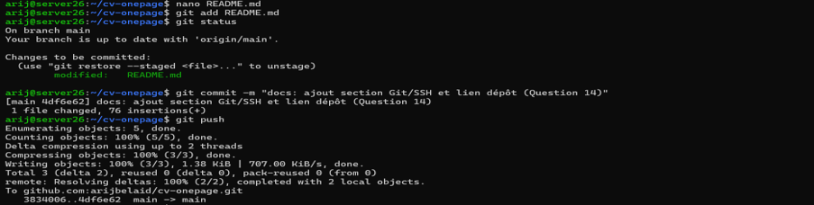

**Nom de la capture :**

```text
17-git-push-github.png
```

---

# 15. Installation et utilisation de Vagrant

## 🎯 Objectif

Introduire l'automatisation de la création de machines virtuelles avec **Vagrant**.

Vagrant permet de définir la configuration d'une VM dans un fichier `Vagrantfile` et de créer automatiquement cette VM.

## 🔄 Mise à jour du système

```bash
sudo apt update
sudo apt upgrade -y
```

## 🔑 Ajout de la clé GPG HashiCorp

La clé officielle HashiCorp est ajoutée afin de permettre l'installation de Vagrant depuis son dépôt.

## 📦 Ajout du dépôt HashiCorp

Le dépôt HashiCorp est ajouté aux sources APT.

## 🚀 Installation de Vagrant

```bash
sudo apt update
sudo apt install vagrant
```

## 🔎 Vérification

```bash
vagrant --version
```

Exemple :

```text
Vagrant x.x.x
```

## 💻 Installation de VirtualBox

VirtualBox est utilisé comme provider pour Vagrant.

## 📁 Création du projet Vagrant

```bash
mkdir vagrant-ubuntu
cd vagrant-ubuntu
```

## 📄 Création du Vagrantfile

```bash
vagrant init generic/ubuntu2204
```

Un fichier :

```text
Vagrantfile
```

est alors créé.

## 📝 Exemple de configuration

```ruby
Vagrant.configure("2") do |config|

  config.vm.box = "generic/ubuntu2204"

  config.vm.provider "virtualbox" do |vb|
    vb.memory = 2048
    vb.cpus = 2
  end

end
```

## 🚀 Création automatique de la VM

```bash
vagrant up
```

Vagrant télécharge la box si nécessaire puis crée et démarre automatiquement la VM.

## 🔎 Vérification

```bash
vagrant status
```

La VM doit apparaître comme active.

## 📸 Capture 18 — Installation de Vagrant

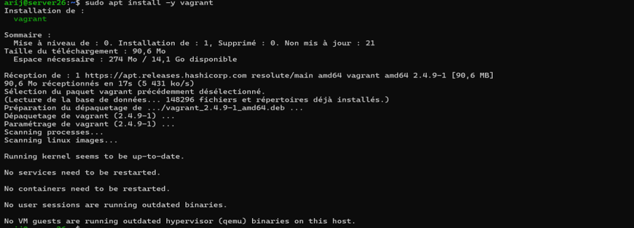

**Nom de la capture :**

```text
18-vagrant-installation.png
```

## 📸 Capture 19 — Vagrantfile

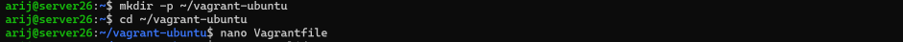

**Nom de la capture :**

```text
19-vagrantfile.png
```

## 📸 Capture 20 — Vagrant Up

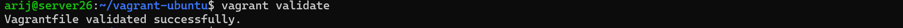

**Nom de la capture :**

```text
20-vagrant-up.png
```

---

# 16. Connexion avec `vagrant ssh`

## 🎯 Objectif

Se connecter directement à la VM créée automatiquement par Vagrant.

## 🔐 Connexion

Depuis le répertoire contenant le `Vagrantfile` :

```bash
vagrant ssh
```

Cette commande ouvre directement une session SSH vers la VM gérée par Vagrant.

## 📸 Capture 21 — Vagrant SSH

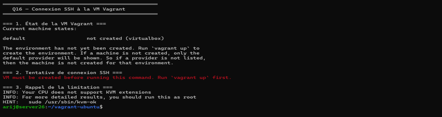

**Nom de la capture :**

```text
21-vagrant-ssh.png
```

## ⚖️ Comparaison : VM manuelle vs Vagrant

| Création manuelle                      | Vagrant                                     |
| -------------------------------------- | ------------------------------------------- |
| Configuration réalisée étape par étape | Configuration définie dans un `Vagrantfile` |
| Création manuelle de la VM             | Création automatisée avec `vagrant up`      |
| Configuration moins reproductible      | Configuration reproductible                 |
| Gestion manuelle des paramètres        | Paramètres définis dans le code             |
| Connexion manuelle                     | Connexion simplifiée avec `vagrant ssh`     |
| Plus longue à reproduire               | Plus rapide à recréer                       |

Vagrant permet donc d'améliorer la **reproductibilité**, l'**automatisation** et la gestion des environnements de développement.

---

# 🐳 Architecture du projet

L'évolution du projet peut être représentée ainsi :

```text
                    ┌─────────────────────┐
                    │    Machine Windows  │
                    │      physique      │
                    └──────────┬──────────┘
                               │
                         SSH / HTTP
                               │
                               ▼
                    ┌─────────────────────┐
                    │   Ubuntu Server VM  │
                    ├─────────────────────┤
                    │         SSH         │
                    │       Jenkins       │
                    │        Docker       │
                    │       Vagrant       │
                    └──────────┬──────────┘
                               │
                               ▼
                    ┌─────────────────────┐
                    │       Docker        │
                    │                     │
                    │  ┌───────────────┐  │
                    │  │ Nginx         │  │
                    │  │ Portfolio     │  │
                    │  └───────────────┘  │
                    └──────────┬──────────┘
                               │
                               ▼
                         GitHub Pages
                               │
                               ▼
              https://arijbelaid.github.io/
                       cv-onepage/
```

---

# 🧰 Technologies utilisées

## Frontend

* HTML5
* CSS3
* JavaScript

## Versionnement

* Git
* GitHub
* GitHub Pages
* SSH

## DevOps / DevSecOps

* Ubuntu Server
* Docker
* Nginx
* Docker Compose
* Jenkins
* Kubernetes
* Ansible
* Terraform
* Argo CD

## Automatisation

* Vagrant
* VirtualBox

---
# 17. Configuration automatique de la VM avec Vagrant

## 🎯 Objectif

Modifier le `Vagrantfile` afin de configurer automatiquement les principaux paramètres de la machine virtuelle :

- Nom de la VM
- Adresse IP privée
- Mémoire RAM
- Nombre de CPU

## 📄 Vagrantfile complet

```ruby
# -*- mode: ruby -*-
# vi: set ft=ruby :

Vagrant.configure("2") do |config|

  # Box Ubuntu Server
  config.vm.box = "generic/ubuntu2204"

  # 1. Nom de la VM (hostname)
  config.vm.hostname = "vagrant-ubuntu"

  # 2. Adresse IP privée
  config.vm.network "private_network", ip: "192.168.56.10"

  # Provider VirtualBox
  config.vm.provider "virtualbox" do |vb|

    # Nom dans VirtualBox
    vb.name = "vagrant-ubuntu"

    # 3. Mémoire RAM (en Mo)
    vb.memory = 1024

    # 4. Nombre de vCPU
    vb.cpus = 2

    # Désactivation de la virtualisation imbriquée (limitation VT-x de l'hôte)
    vb.customize ["modifyvm", :id, "--hwvirtex", "off"]
    vb.customize ["modifyvm", :id, "--nestedpaging", "off"]
    vb.customize ["modifyvm", :id, "--paravirtprovider", "none"]
  end

  # Provisionnement : mise à jour du système
  config.vm.provision "shell", inline: <<-SHELL
    apt-get update -y
    apt-get upgrade -y
  SHELL

end
```

## 🔍 Détail des 4 configurations

| # | Ligne du Vagrantfile | Valeur | Rôle |
|---|---|---|---|
| **1** | `config.vm.hostname` | `vagrant-ubuntu` | Nom d'hôte de la VM |
| **1** | `vb.name` | `vagrant-ubuntu` | Nom affiché dans VirtualBox |
| **2** | `config.vm.network "private_network"` | `192.168.56.10` | Adresse IP privée |
| **3** | `vb.memory` | `1024` (Mo) | Mémoire RAM allouée |
| **4** | `vb.cpus` | `2` | Nombre de vCPU |

## ✅ Validation du Vagrantfile

```bash
cd ~/vagrant-ubuntu
vagrant validate
```

**Résultat :**

```text
Vagrantfile validated successfully.
```

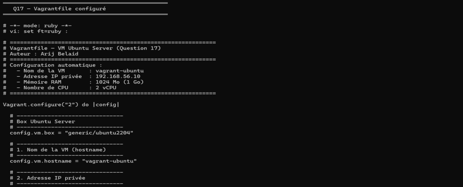

## 📸 Capture — Détail du Vagrantfile

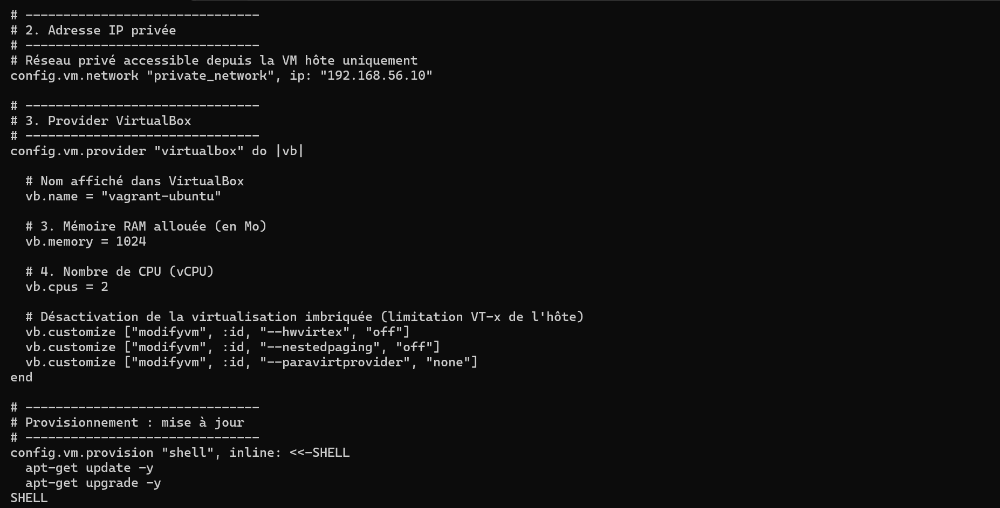

## 🔎 État de la VM avec `vagrant status`

```bash
vagrant status
```

**Résultat observé :**

```text
Current machine states:

default                   not created (virtualbox)

The environment has not yet been created. Run `vagrant up` to
create the environment.
```

⚠️ **Limitation rencontrée** : l'environnement de TP (VM Ubuntu hébergée sur
VMware, sans support de la virtualisation imbriquée VT-x) ne permet pas à
`vagrant up` de créer la VM. Le Vagrantfile est néanmoins **valide** et
**serait pleinement fonctionnel** sur une machine avec accès à la virtualisation
matérielle.

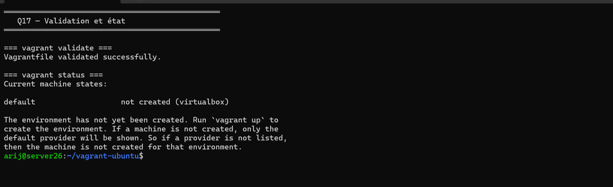

## 🎁 Avantages de la configuration dans le Vagrantfile

- ✅ **Reproductibilité** : la VM est identique sur toutes les machines
- ✅ **Versionnement** : le fichier est versionné dans Git
- ✅ **Documentation** : la configuration est explicite et lisible
- ✅ **Automatisation** : `vagrant up` crée la VM sans intervention manuelle
- ✅ **Modification rapide** : changer la RAM ou les CPU se fait en 1 ligne

---

# 18. Nouvelle version du Portfolio avec Next.js

## 🎯 Objectif

Créer une nouvelle version du DevSecOps Portfolio en utilisant **Next.js 16**,
en conservant les sections principales : About / Skills / Projects / Experience / Contact.

## 🛠️ Prérequis : Node.js

```bash
sudo apt update
sudo apt install -y nodejs npm
node --version   # → v22.22.1
npm --version    # → 9.2.0
```

## 🚀 Commande de création du projet

```bash
cd ~
npx create-next-app@latest devsecops-portfolio-next
```

**Configuration choisie :**

| Option | Valeur |
|---|---|
| TypeScript | Yes |
| ESLint | Yes |
| Tailwind CSS | Yes |
| `src/` directory | No |
| App Router | Yes |
| Turbopack | Yes |

## 📁 Structure du projet

```text
devsecops-portfolio-next/
├── app/
│   ├── layout.tsx      # Layout racine (navbar + footer)
│   ├── page.tsx        # Page d'accueil avec les 5 sections
│   └── globals.css     # Styles Tailwind
├── public/
├── postcss.config.mjs
├── package.json
├── next.config.ts
└── tsconfig.json
```

## 🏃 Lancer le serveur de développement

```bash
cd ~/devsecops-portfolio-next
npm run dev
```

**Résultat :**

```text
▲ Next.js 16.4.0 (Turbopack)
- Local:         http://localhost:3000
- Network:       http://192.168.159.129:3000
✓ Ready in 1670ms
```

Accès depuis la machine physique : **http://192.168.159.129:3000**

## 📸 Capture de l'application Next.js

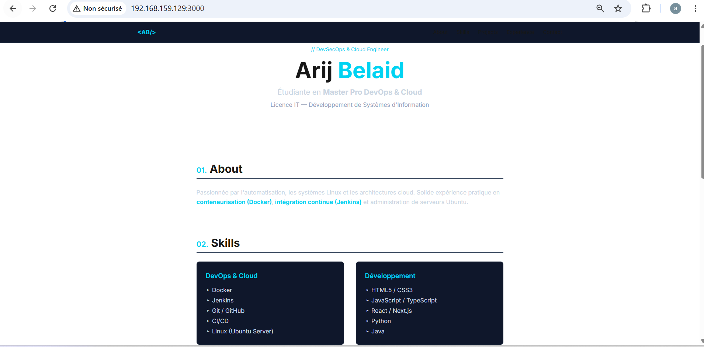

## ✅ Avantages de Next.js

- ✅ **Composants réutilisables** : architecture modulaire avec React
- ✅ **Routage par fichiers** : pas de configuration manuelle
- ✅ **Server Components** : meilleures performances
- ✅ **Optimisation automatique** : images, polices, scripts
- ✅ **Écosystème React** : accès à des milliers de bibliothèques
- ✅ **Prêt pour la production** : build optimisé (`npm run build`)

---

# 19. Refactorisation en composants réutilisables

## 🎯 Objectif

Transformer les principales parties du Portfolio Next.js en **composants
réutilisables** : Header, About, Skills, Projects, Contact, Footer.

## 📁 Structure des composants

```text
devsecops-portfolio-next/
├── app/
│   ├── layout.tsx          # Importe <Header /> et <Footer />
│   ├── page.tsx            # Importe <About />, <Skills />, <Projects />, <Contact />
│   └── globals.css
├── components/             # ⭐ Nouveau dossier
│   ├── Header.tsx
│   ├── About.tsx
│   ├── Skills.tsx
│   ├── Projects.tsx
│   ├── Contact.tsx
│   └── Footer.tsx
├── public/
├── postcss.config.mjs
└── package.json
```

## 📋 Détail des 6 composants

| Composant | Fichier | Rôle |
|---|---|---|
| **Header** | `components/Header.tsx` | Navbar sticky avec les liens |
| **About** | `components/About.tsx` | Section 01 — Présentation |
| **Skills** | `components/Skills.tsx` | Section 02 — Compétences |
| **Projects** | `components/Projects.tsx` | Section 03 — Projets |
| **Contact** | `components/Contact.tsx` | Section 05 — Coordonnées |
| **Footer** | `components/Footer.tsx` | Pied de page |

## 📋 Exemple — `components/Header.tsx`

```tsx
export default function Header() {
  return (
    <header className="bg-slate-900 border-b border-slate-800 p-4 sticky top-0 z-50">
      <nav className="max-w-6xl mx-auto flex justify-between items-center">
        <span className="font-mono font-bold text-cyan-400">&lt;AB/&gt;</span>
        <ul className="flex gap-6 text-sm">
          <li><a href="#about" className="hover:text-cyan-400">About</a></li>
          <li><a href="#skills" className="hover:text-cyan-400">Skills</a></li>
          <li><a href="#projects" className="hover:text-cyan-400">Projects</a></li>
          <li><a href="#contact" className="hover:text-cyan-400">Contact</a></li>
        </ul>
      </nav>
    </header>
  );
}
```

## ✅ Avantages

- ✅ **Réutilisabilité** : chaque composant peut être importé ailleurs
- ✅ **Lisibilité** : 1 fichier = 1 responsabilité
- ✅ **Maintenabilité** : modification d'une section = 1 fichier
- ✅ **Testabilité** : chaque composant testable indépendamment
- ✅ **Collaboration** : plusieurs devs en parallèle

## 📸 Captures

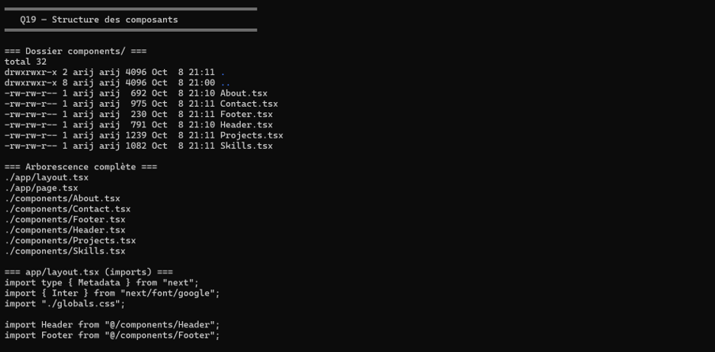

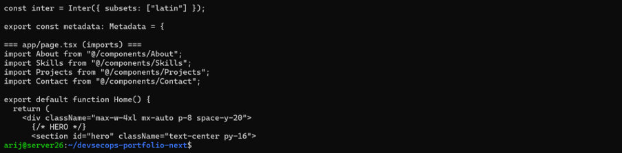

---

# 20. Séparation des données dans des fichiers dédiés

## 🎯 Objectif

Déplacer les données des projets et compétences dans des **fichiers séparés**
au lieu de les avoir en dur dans les composants.

## 📁 Structure du dossier `data/`

```text
devsecops-portfolio-next/
├── components/
├── data/                    # ⭐ Nouveau dossier
│   ├── skills.ts            # Compétences
│   ├── projects.ts          # Projets
│   ├── contacts.ts          # Contacts
│   ├── experiences.ts       # Expériences
│   └── index.ts             # Barrel file
└── app/
```

## 📄 Exemple — `data/skills.ts`

```typescript
export interface SkillGroup {
  category: string;
  items: string[];
}

export const skillsData: SkillGroup[] = [
  {
    category: "DevOps & Cloud",
    items: ["Docker", "Jenkins", "Git / GitHub", "CI/CD", "Linux (Ubuntu Server)"],
  },
  {
    category: "Développement",
    items: ["HTML5 / CSS3", "JavaScript / TypeScript", "React / Next.js", "Python", "Java"],
  },
];
```

## 📄 Exemple — `data/projects.ts`

```typescript
export interface Project {
  slug: string;
  title: string;
  description: string;
  longDescription?: string;
  tags: string[];
  year: string;
  link?: string;
}

export const projectsData: Project[] = [
  {
    slug: "cicd-ubuntu-server",
    title: "Chaîne CI/CD complète sur Ubuntu Server",
    description: "Installation et durcissement d'un serveur Ubuntu Server 26.04...",
    tags: ["Ubuntu", "Docker", "Jenkins", "SSH", "UFW"],
    year: "2026",
    link: "https://github.com/arijbelaid/cv-onepage",
  },
  // ...
];
```

## 📄 Barrel file — `data/index.ts`

```typescript
export * from "./skills";
export * from "./projects";
export * from "./contacts";
export * from "./experiences";
```

Ainsi, dans un composant :
```typescript
import { skillsData, projectsData } from "@/data";
```

## ✅ Avantages

- ✅ **Séparation des responsabilités** : données ≠ présentation
- ✅ **Réutilisabilité** : même donnée utilisable par plusieurs composants
- ✅ **Maintenabilité** : ajout d'un projet = 1 ligne
- ✅ **Typage TypeScript** : interfaces garantissant la structure

## 📸 Captures

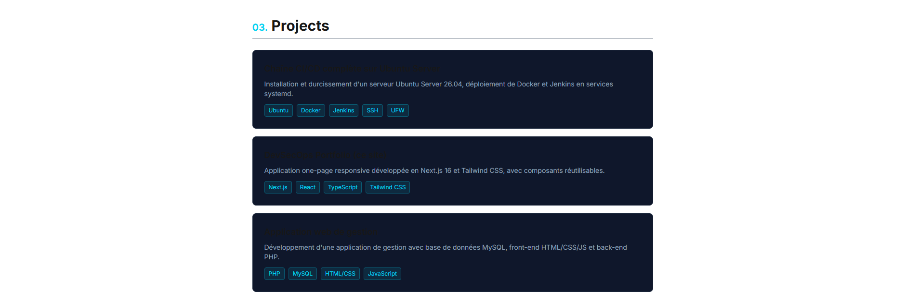


---

# 21. Pages dédiées aux projets

## 🎯 Objectif

Ajouter des pages dédiées :
- `/projects` → Liste de tous les projets
- `/projects/[slug]` → Détail d'un projet

## 📁 Structure des routes

```text
app/
├── page.tsx                    # Accueil
└── projects/                   # ⭐ Nouvelles routes
    ├── page.tsx                # /projects (liste)
    └── [slug]/
        └── page.tsx            # /projects/[slug] (détail)
```

## 📄 `app/projects/page.tsx` — Liste des projets

```tsx
import Link from "next/link";
import { projectsData } from "@/data";

export default function ProjectsPage() {
  return (
    <div className="max-w-4xl mx-auto p-8">
      <h1 className="text-4xl font-bold mb-8">Mes Projets</h1>
      <div className="space-y-4">
        {projectsData.map((project) => (
          <Link key={project.slug} href={`/projects/${project.slug}`}>
            <article className="bg-slate-900 border border-slate-800 rounded-lg p-6 hover:border-cyan-400">
              <h2 className="text-xl font-semibold">{project.title}</h2>
              <p className="text-slate-400 text-sm mt-2">{project.description}</p>
            </article>
          </Link>
        ))}
      </div>
    </div>
  );
}
```

## 📄 `app/projects/[slug]/page.tsx` — Détail d'un projet

```tsx
import Link from "next/link";
import { notFound } from "next/navigation";
import { projectsData } from "@/data";

interface Props {
  params: Promise<{ slug: string }>;
}

export async function generateStaticParams() {
  return projectsData.map((project) => ({ slug: project.slug }));
}

export default async function ProjectPage({ params }: Props) {
  const { slug } = await params;
  const project = projectsData.find((p) => p.slug === slug);

  if (!project) notFound();

  return (
    <div className="max-w-3xl mx-auto p-8">
      <Link href="/projects">← Tous les projets</Link>
      <h1 className="text-4xl font-bold mt-8">{project.title}</h1>
      <p className="text-slate-400 mt-4">{project.longDescription}</p>
    </div>
  );
}
```

## 🔗 Navigation

- Le Header pointe vers `/projects` (avec `<Link>`)
- Les cartes de la page d'accueil pointent vers `/projects/[slug]`
- La page détail a un lien retour vers `/projects`

## 📸 Captures

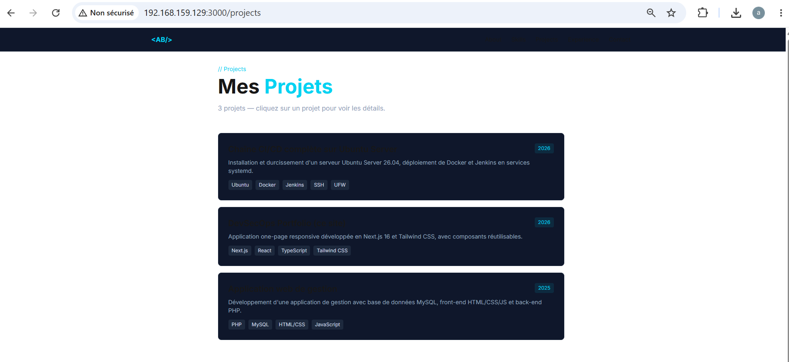

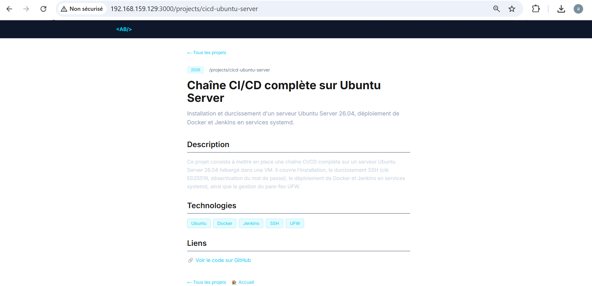

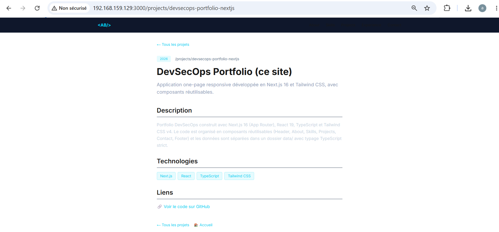

---

# 22. Premier Jenkins Pipeline

## 🎯 Objectif

Créer un premier **Jenkins Pipeline** capable de récupérer automatiquement
le dépôt GitHub du DevSecOps Portfolio.

## 📄 Jenkinsfile

```groovy
pipeline {
    agent any

    stages {
        stage('Checkout') {
            steps {
                echo '🔄 Récupération du dépôt GitHub...'
                checkout scm
                script {
                    def branch = sh(script: "git rev-parse --abbrev-ref HEAD", returnStdout: true).trim()
                    def commit = sh(script: "git rev-parse --short HEAD", returnStdout: true).trim()
                    echo "📚 Branche : ${branch}"
                    echo "🔖 Commit : ${commit}"
                }
            }
        }

        stage('Verify') {
            steps {
                echo '✅ Vérification des fichiers du projet...'
                sh 'ls -la'
                sh 'test -f index.html && echo "✓ index.html trouvé"'
                sh 'test -f nextjs-portfolio/package.json && echo "✓ nextjs-portfolio/package.json trouvé"'
            }
        }
    }

    post {
        success {
            echo '✅ Pipeline terminé avec succès !'
        }
        failure {
            echo '❌ Le pipeline a échoué.'
        }
    }
}
```

## ⚙️ Configuration Jenkins

| Paramètre | Valeur |
|---|---|
| **Job name** | `DevSecOps-Portfolio-Pipeline` |
| **Type** | Pipeline |
| **Definition** | Pipeline script from SCM |
| **SCM** | Git |
| **Repository URL** | `https://github.com/arijbelaid/cv-onepage.git` |
| **Branch Specifier** | `*/main` |
| **Script Path** | `Jenkinsfile` |

## ✅ Résultat

- Build `#1` : ✅ **SUCCESS**
- Durée : 30 secondes
- Récupération automatique du dépôt GitHub confirmée

## 📸 Captures

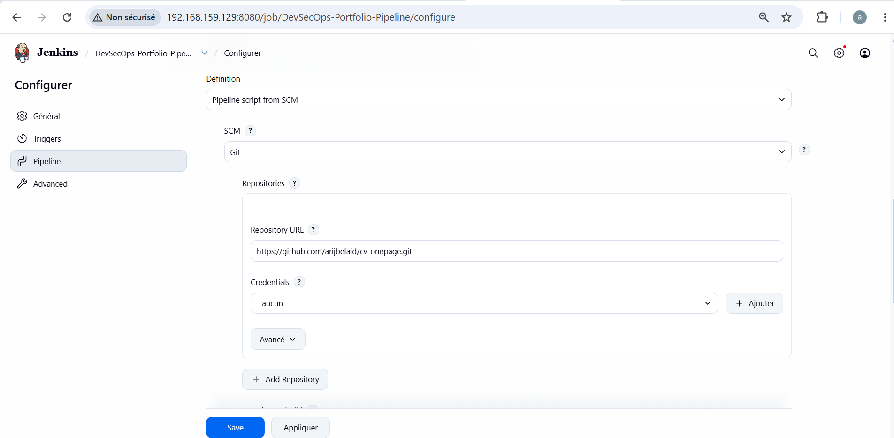

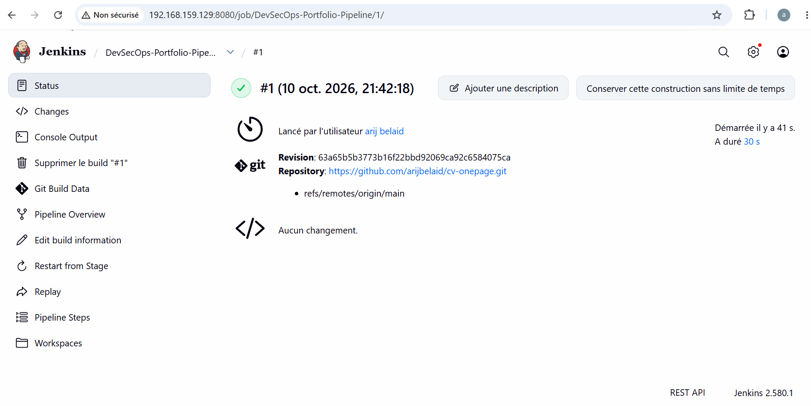

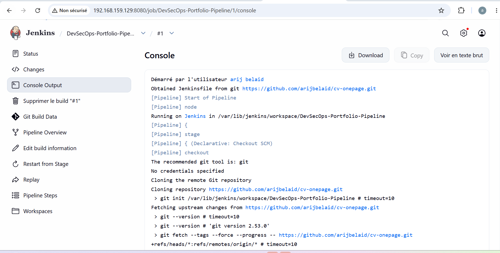

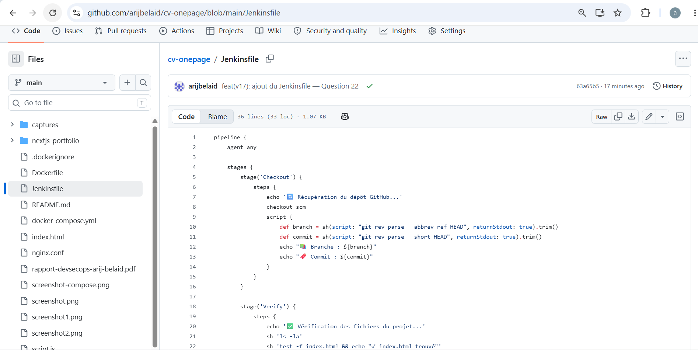

---

# 23. Installation des dépendances Next.js dans le pipeline

## 🎯 Objectif

Ajouter un stage au pipeline Jenkins pour installer automatiquement les
dépendances du projet Next.js (`npm install`).

## 🛠️ Installation du plugin NodeJS

Dans Jenkins :
1. **Manage Jenkins** → **Plugins** → **Available plugins**
2. Rechercher **NodeJS** → Installer
3. **Manage Jenkins** → **Tools** → **NodeJS** → Ajouter :
   - **Name** : `nodejs-22`
   - **Install automatically** : ☑️
   - **Version** : Node.js 22.x

## 📄 Jenkinsfile mis à jour

```groovy
pipeline {
    agent any

    tools {
        nodejs 'nodejs-22'
    }

    stages {
        stage('Checkout') { /* ... */ }
        stage('Verify') { /* ... */ }

        stage('Install Dependencies') {
            steps {
                echo '📦 Installation des dépendances Next.js...'
                dir('nextjs-portfolio') {
                    sh 'node --version'
                    sh 'npm --version'
                    sh 'npm install'
                }
            }
        }
    }
}
```

## ✅ Résultat

- Build `#2` : ✅ **SUCCESS**
- Durée : 1 min 14 s
- **371 packages installés** par `npm install`

## 📸 Captures

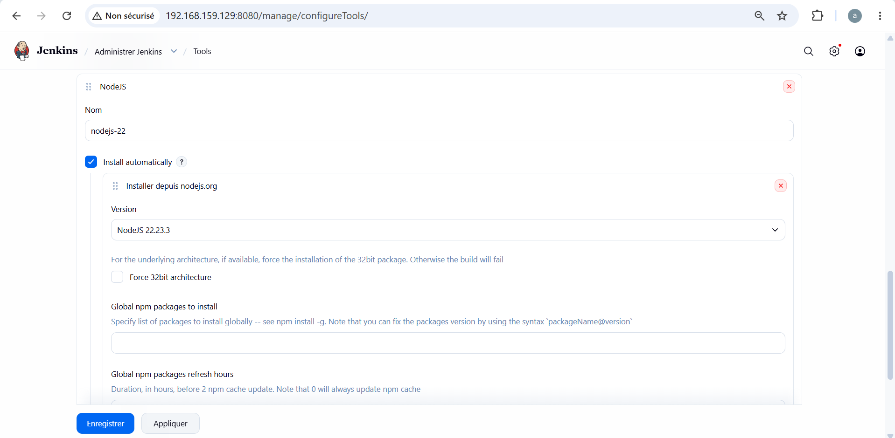

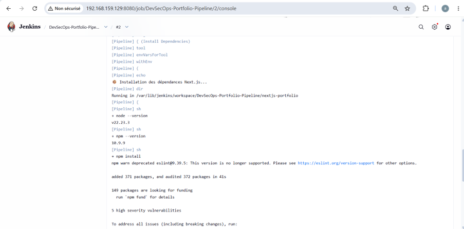


---

# 24. Build de l'application Next.js dans le pipeline

## 🎯 Objectif

Ajouter un stage au pipeline Jenkins pour construire automatiquement
l'application Next.js en mode production (`npm run build`).

## 📄 Jenkinsfile mis à jour

```groovy
pipeline {
    agent any

    tools {
        nodejs 'nodejs-22'
    }

    stages {
        stage('Checkout') { /* ... */ }
        stage('Verify') { /* ... */ }
        stage('Install Dependencies') { /* ... */ }

        stage('Build') {
            steps {
                echo '🏗️ Construction de l\'application Next.js...'
                dir('nextjs-portfolio') {
                    sh 'npm run build'
                    sh 'ls -la .next/ | head -10'
                }
            }
        }
    }
}
```

## ✅ Résultat

- Build `#3` : ✅ **SUCCESS**
- `npm run build` exécuté :
  - **Next.js 16.4.0** (Turbopack)
  - **Compiled successfully in 6.1s**
  - **TypeScript vérifié**
  - **8 pages statiques générées**
- Dossier **`.next/`** créé avec les fichiers de production

## 📸 Captures

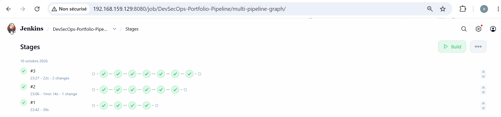

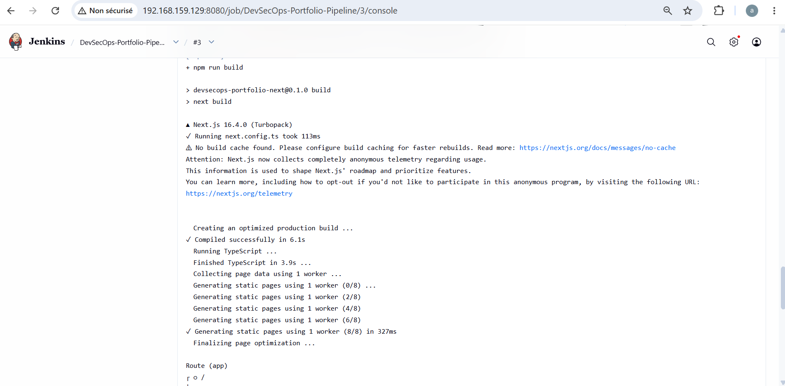

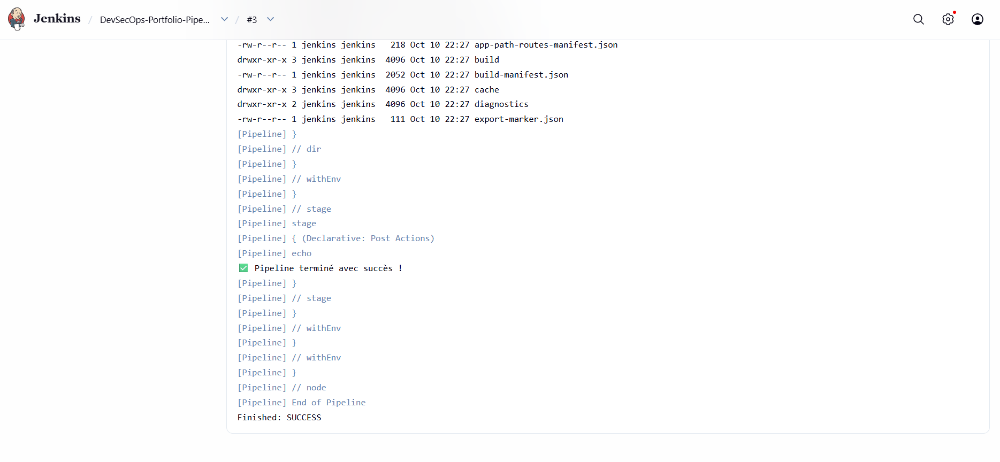

---

---

# 🎯 Objectif de l'Activité 3

Cette troisième et dernière activité a pour but de professionnaliser l'architecture du projet en ajoutant :
1. **L'automatisation** de la configuration avec **Ansible**.
2. Le développement d'une **API Node.js / Express** indépendante pour servir les données du portfolio.
3. La **connexion du Frontend Next.js** à cette API en utilisant des variables d'environnement.
4. La **conteneurisation** de l'API et du Frontend avec Docker, et leur orchestration conjointe via **Docker Compose**.

---

# VII. Automatisation avec Ansible

### 25. Installation d'Ansible

Ansible a été installé sur la VM d'administration (`server26`) pour automatiser la configuration des serveurs distants.

**Commande d'installation :**
\`\`\`bash
sudo apt update
sudo apt install -y ansible
ansible --version
\`\`\`

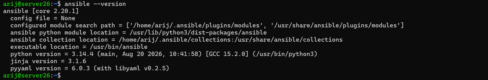

### 26. Fichier inventory et test de communication

Un fichier `inventory` a été créé pour lister la VM cible (`vm-cible`). La communication a été testée avec succès via le module `ping` d'Ansible.

**Fichier `ansible/inventory` :**
\`\`\`ini
[servers]
vm-cible ansible_host=192.168.159.15 ansible_user=arij
\`\`\`

**Commande de test :**
\`\`\`bash
cd ~/cv-onepage/ansible
ansible all -i inventory -m ping
\`\`\`

**Résultat :** `vm-cible | SUCCESS => { "ping": "pong" }`

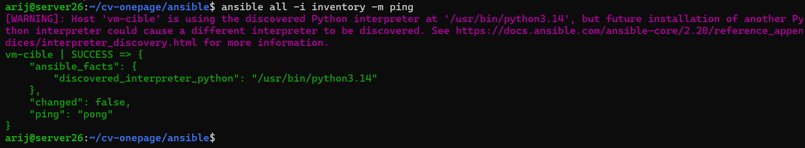

### 27. Premier playbook Ansible (installation de packages)

Un playbook a été créé pour installer automatiquement `git` et `curl` sur la VM cible.

**Fichier `ansible/install_packages.yml` :**
\`\`\`yaml
---
- name: Installer des packages de base (git et curl)
  hosts: all
  become: true
  tasks:
    - name: Mettre à jour le cache APT
      apt:
        update_cache: yes
    - name: Installer git et curl
      apt:
        name:
          - git
          - curl
        state: present
\`\`\`

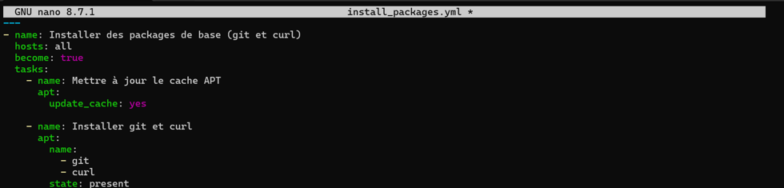

**Commande d'exécution :**
\`\`\`bash
ansible-playbook -i inventory install_packages.yml
\`\`\`

**Résultat :** `failed=0`, les packages sont installés avec succès.

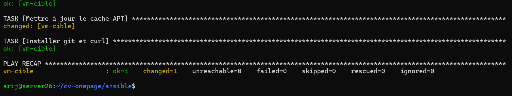

### 28. Playbook Ansible pour installer Docker

Un playbook a été créé pour installer Docker de A à Z sur la VM cible.

**Fichier `ansible/install_docker.yml` :**
\`\`\`yaml
---
- name: Installer Docker sur la VM cible
  hosts: all
  become: true
  tasks:
    - name: Installer les dépendances requises
      apt:
        name: [ca-certificates, curl, gnupg]
        state: present
        update_cache: yes
    - name: Créer le dossier des clés APT
      file:
        path: /etc/apt/keyrings
        state: directory
        mode: '0755'
    - name: Télécharger la clé GPG officielle de Docker
      get_url:
        url: https://download.docker.com/linux/ubuntu/gpg
        dest: /etc/apt/keyrings/docker.asc
        mode: '0644'
    - name: Ajouter le dépôt Docker
      apt_repository:
        repo: "deb [arch=amd64 signed-by=/etc/apt/keyrings/docker.asc] https://download.docker.com/linux/ubuntu {{ ansible_distribution_release }} stable"
        state: present
    - name: Installer Docker et ses composants
      apt:
        name: [docker-ce, docker-ce-cli, containerd.io, docker-buildx-plugin, docker-compose-plugin]
        state: present
        update_cache: yes
    - name: Démarrer et activer le service Docker
      systemd:
        name: docker
        state: started
        enabled: yes
\`\`\`

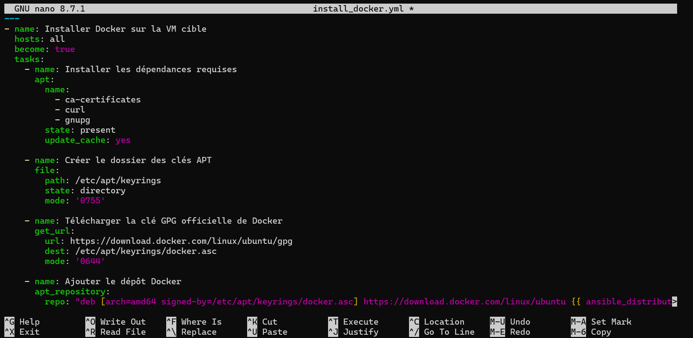

**Vérification :**
\`\`\`bash
ansible all -i inventory -m command -a "docker --version"
# Résultat : Docker version 29.9.2
\`\`\`

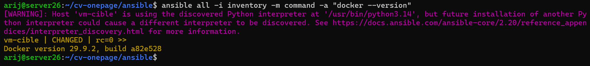

---

# VIII. Création de l'API Node.js / Express

### 29. Création de l'API Node.js / Express

Une API indépendante a été créée dans le dossier `api/`. Elle utilise Node.js et le framework Express.

**Structure du dossier `api/` :**
\`\`\`text
cv-onepage/api/
├── index.js          # Serveur Express
├── package.json      # Dépendances
└── node_modules/
\`\`\`

**Démarrage :**
\`\`\`bash
cd ~/cv-onepage/api
node index.js
# 🚀 Serveur API démarré sur http://localhost:5000
\`\`\`

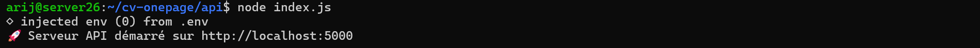
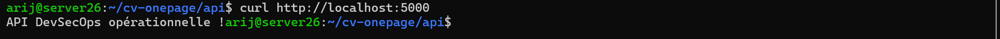

### 30. Route GET /api/health

Cette route permet de vérifier que l'API est opérationnelle.

\`\`\`javascript
app.get('/api/health', (req, res) => {
  res.status(200).json({
    status: "OK",
    message: "L'API est opérationnelle",
    timestamp: new Date().toISOString()
  });
});
\`\`\`

**Test :** `curl http://localhost:5000/api/health`

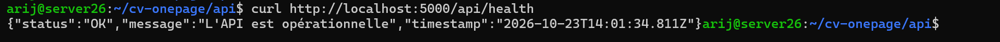

### 31. Route GET /api/profile

Cette route retourne les informations principales du portfolio au format JSON.

\`\`\`javascript
app.get('/api/profile', (req, res) => {
  res.status(200).json({
    name: "Arij Belaid",
    title: "Étudiante en Master Pro DevOps & Cloud",
    location: "Tunisie",
    email: "aarijbelaid@gmail.com",
    github: "https://github.com/arijbelaid",
    bio: "Passionnée par l'automatisation..."
  });
});
\`\`\`

**Test :** `curl http://localhost:5000/api/profile`

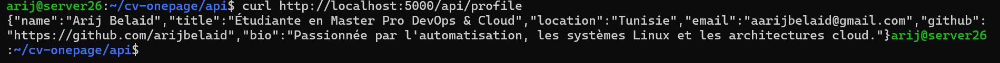

### 32. Route GET /api/projects

Cette route retourne la liste des projets du portfolio.

\`\`\`javascript
app.get('/api/projects', (req, res) => {
  const projects = [
    { slug: "cicd-ubuntu-server", title: "Chaîne CI/CD...", tags: ["Ubuntu", "Docker"...] },
    // ... autres projets
  ];
  res.status(200).json(projects);
});
\`\`\`

**Test :** `curl http://localhost:5000/api/projects`


### 33. Route GET /api/skills

Cette route retourne la liste des compétences.

\`\`\`javascript
app.get('/api/skills', (req, res) => {
  const skills = [
    { category: "DevOps & Cloud", items: ["Docker", "Jenkins"...] },
    { category: "Développement", items: ["HTML5 / CSS3"...] }
  ];
  res.status(200).json(skills);
});
\`\`\`

**Test :** `curl http://localhost:5000/api/skills`


### 34. Connexion du Frontend Next.js à l'API Express (Projets)

Le composant `Projects.tsx` a été modifié pour utiliser `fetch` et récupérer les données dynamiquement depuis l'API, au lieu d'utiliser des données locales.

**Explication :** L'utilisation de `useState` et `useEffect` permet de faire un appel asynchrone vers l'API. Le frontend et le backend sont maintenant découplés.

\`\`\`tsx
useEffect(() => {
  fetch(`${process.env.NEXT_PUBLIC_API_URL}/api/projects`)
    .then(res => res.json())
    .then(data => setProjects(data));
}, []);
\`\`\`


### 35. Connexion du Frontend Next.js à l'API Express (Compétences)

De la même manière, le composant `Skills.tsx` a été modifié pour récupérer les compétences dynamiquement via l'API.

\`\`\`tsx
useEffect(() => {
  fetch(`${process.env.NEXT_PUBLIC_API_URL}/api/skills`)
    .then(res => res.json())
    .then(data => setSkills(data));
}, []);
\`\`\`


---

# IX. Variables d'environnement et configuration

### 36. Configuration de l'URL de l'API via variable d'environnement

L'URL de l'API a été extraite du code source et placée dans une variable d'environnement (`NEXT_PUBLIC_API_URL`).

**Fichier `.env.local` :**
\`\`\`env
NEXT_PUBLIC_API_URL=http://192.168.159.129:5000
\`\`\`


**Pourquoi l'URL de l'API ne doit pas être codée en dur ?**
1. **Flexibilité** : L'URL change selon l'environnement (développement local, serveur de test, production). Avec une variable, on change la configuration sans modifier le code.
2. **Sécurité** : Coder en dur expose les adresses IP internes dans le dépôt Git public.
3. **Bonnes pratiques** : C'est le standard (12-Factor App) de séparer la configuration du code.

### 37. Fichier d'exemple de variables d'environnement

Un fichier `.env.example` a été créé. Il sert de modèle pour les autres développeurs en listant les variables nécessaires sans exposer les vraies valeurs. Le fichier `.env.local` est lui ignoré par Git.

**Contenu du fichier `.env.example` :**
\`\`\`env
# URL de l'API Express
NEXT_PUBLIC_API_URL=http://localhost:5000
\`\`\`


---

# X. Dockerisation frontend + API

### 38. Dockerfile pour le Frontend Next.js

Un Dockerfile "multi-stage" a été créé pour le frontend. L'étape `builder` compile l'application, puis l'étape `runner` ne garde que le strict nécessaire pour la production, rendant l'image beaucoup plus légère.

**Fichier `nextjs-portfolio/Dockerfile` :**
\`\`\`dockerfile
FROM node:22-alpine AS builder
WORKDIR /app
COPY package*.json ./
RUN npm install
COPY . .
ENV NEXT_TELEMETRY_DISABLED=1
RUN npm run build

FROM node:22-alpine AS runner
WORKDIR /app
ENV NODE_ENV=production
ENV NEXT_TELEMETRY_DISABLED=1
COPY --from=builder /app/package*.json ./
COPY --from=builder /app/node_modules ./node_modules
COPY --from=builder /app/.next ./.next
COPY --from=builder /app/public ./public
EXPOSE 3000
CMD ["npm", "start"]
\`\`\`


### 39. Dockerfile pour l'API Node.js / Express

Un Dockerfile simple a été créé pour l'API. Il utilise l'image légère `node:22-alpine` et installe uniquement les dépendances de production.

**Fichier `api/Dockerfile` :**
\`\`\`dockerfile
FROM node:22-alpine
WORKDIR /app
COPY package*.json ./
RUN npm install --production
COPY . .
EXPOSE 5000
CMD ["node", "index.js"]
\`\`\`


### 40. Construction des images Docker

Deux images Docker ont été construites : `devsecops-portfolio` et `devsecops-api`.

**Commandes utilisées :**
\`\`\`bash
docker build -t devsecops-portfolio ./nextjs-portfolio
docker build -t devsecops-api ./api
docker images | grep -E "devsecops-portfolio|devsecops-api"
\`\`\`


### 41. Docker Compose pour l'API et le Frontend

Un fichier `docker-compose.yml` a été créé à la racine du projet pour lancer l'API et le Frontend ensemble dans un réseau Docker commun.

**Fichier `docker-compose.yml` :**
\`\`\`yaml
services:
  api:
    image: devsecops-api
    container_name: devsecops-api-container
    ports:
      - "5000:5000"
    networks:
      - devsecops-network

  frontend:
    image: devsecops-portfolio
    container_name: devsecops-frontend-container
    ports:
      - "3000:3000"
    environment:
      - NEXT_PUBLIC_API_URL=http://192.168.159.129:5000
    depends_on:
      - api
    networks:
      - devsecops-network

networks:
  devsecops-network:
    driver: bridge
\`\`\`


**Commande de lancement :**
\`\`\`bash
docker compose up -d
docker compose ps
\`\`\`


### 42. Vérification de la communication via Docker Compose

Le portfolio a été testé depuis la machine physique pour s'assurer que le Frontend (dans son conteneur) communique bien avec l'API (dans son conteneur) via le réseau Docker.

**Explication :**
Docker Compose crée un réseau interne (`devsecops-network`) qui permet aux conteneurs de se parler. L'API expose le port 5000 vers l'extérieur, et le navigateur du client fait une requête vers l'IP de la VM sur ce port. Le Frontend, compilé avec la variable `NEXT_PUBLIC_API_URL`, sait exactement où chercher les données.


---
**Explication :**
Docker Compose crée un réseau interne (`devsecops-network`) qui permet aux conteneurs de se parler. L'API expose le port 5000 vers l'extérieur, et le navigateur du client fait une requête vers l'IP de la VM sur ce port. Le Frontend, compilé avec la variable `NEXT_PUBLIC_API_URL`, sait exactement où chercher les données.


---

